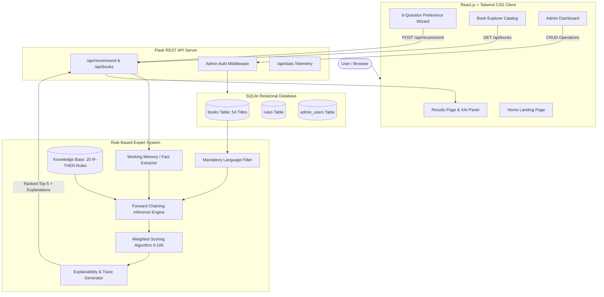
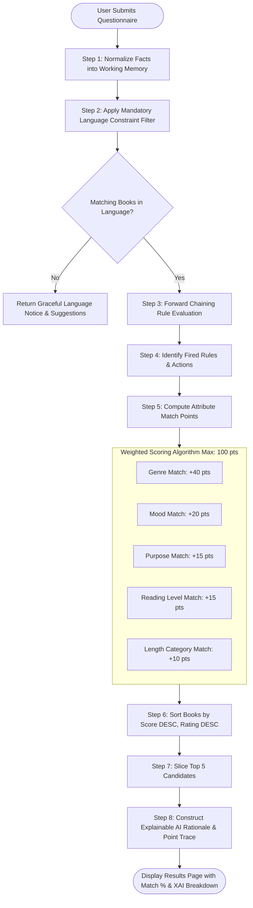

# SmartBook – Intelligent Rule-Based Book Recommendation System

> **Artificial Intelligence Mini Project | Computer Engineering**  
> *An Explainable AI (XAI) Rule-Based Expert System using Forward Chaining & Weighted Scoring.*

---

## 📌 1. Project Introduction & Abstract
**SmartBook** is a full-stack, modern web application designed to recommend books using **traditional rule-based Artificial Intelligence**. Rather than relying on non-deterministic statistical models or black-box machine learning APIs, SmartBook implements a classical **expert system** powered by predefined **IF–THEN rules**, **forward-chaining reasoning**, and a **transparent weighted scoring algorithm**.

The platform features an authentic multilingual catalog of **54+ books** across **English, Hindi, and Marathi**, providing tailored literary suggestions alongside natural-language justifications under an **Explainable AI (XAI)** framework.

---

## 🎯 2. Problem Statement & Objectives

### Problem Statement
Modern machine learning recommenders (e.g., collaborative filtering or large language models) function as opaque "black boxes." They suffer from:
1. **Cold-start latency** (requiring extensive user histories before generating meaningful suggestions).
2. **Hallucinations or non-existent citations** (common in LLM-based systems).
3. **Lack of auditability** (inability to verify why a specific book was suggested).

### Project Objectives
- Build a pure **Rule-Based Expert System** that operates without external AI APIs or statistical ML packages.
- Implement **Forward Chaining Inference** to deduce suitable recommendations from user-asserted facts.
- Design a deterministic **Weighted Scoring Formula (0–100%)** that avoids double-counting.
- Enforce a **Mandatory Language Constraint Filter** so readers receive books strictly in their preferred language (English, Hindi, or Marathi).
- Offer **Explainable AI (XAI)** traces that expose which rules were triggered and the exact point breakdown for every suggested title.
- Provide a clean, modern digital library UI with a preference wizard, book explorer, and authenticated admin control panel.

---

## 🛠️ 3. Technologies Used

| Layer | Technology | Purpose |
|---|---|---|
| **Frontend Framework** | React.js (v18) + Vite (v6) | Component-driven, ultra-fast client-side application |
| **Styling & Theme** | Tailwind CSS (v3) | Modern digital library design, purple-blue gradient, glassmorphism |
| **Icons & Navigation** | Lucide React + React Router DOM (v6) | Modern iconography and seamless SPA routing |
| **Backend Framework** | Python 3 + Flask (v3) + Flask-CORS | Lightweight REST API server and inference controller |
| **Database** | SQLite3 | Local, zero-configuration relational database |
| **AI Technique** | Rule-Based Expert System | Predefined IF–THEN rules, Working Memory, Forward Chaining |
| **Testing** | Pytest (v8) | Automated unit testing and REST integration tests |

---

## 🏛️ 4. System Architecture

SmartBook follows a modular client-server architecture with complete separation between the presentation tier, API controller, rule inference engine, and persistence layer.



---

## 🧠 5. Rule-Based AI & Forward Chaining

### What is a Rule-Based Expert System?
A rule-based expert system emulates human decision-making by applying logical rules stored in a **Knowledge Base** to observed facts in **Working Memory**.

### Components of the AI Engine:
1. **Working Memory (Facts)**: Stores facts extracted from the user's questionnaire:
   - `genre` (e.g., *Self-Help*)
   - `mood` (e.g., *Motivated*)
   - `reading_difficulty` (e.g., *Beginner*)
   - `preferred_length` (e.g., *Medium*)
   - `language` (e.g., *English*)
   - `reading_purpose` (e.g., *Personal Development*)
2. **Knowledge Base (Rules)**: 20 structured IF–THEN rules in `rules.py` covering genre pairings, mood synergies, experience adaptations, and reading goals.
3. **Inference Engine (Forward Chaining)**:
   - Reads the input facts (data-driven reasoning).
   - Iterates through the rule base to find all rules whose premise (`IF` clause) is fully satisfied.
   - Fires active rules to assert recommendations and scoring adjustments.

### Example Predefined Rules
- **RULE 01**: `IF genre = 'Mystery' AND mood = 'Curious' THEN recommend Mystery and Detective books.`
- **RULE 02**: `IF genre = 'Self-Help' AND reading_purpose = 'Motivation' THEN recommend motivational and personal development books.`
- **RULE 03**: `IF genre = 'Technology' AND reading_purpose = 'Learning' THEN recommend programming and software architecture books.`
- **RULE 06**: `IF reading_difficulty = 'Beginner' THEN prioritize books with easy reading difficulty.`
- **RULE 08**: `IF language = 'Marathi' THEN filter catalog strictly to Marathi literature.`

---

## ⚙️ 6. Recommendation Algorithm & Flowchart



### Deterministic Weighted Scoring Table
$$\text{Score} = W_{\text{genre}} + W_{\text{mood}} + W_{\text{purpose}} + W_{\text{difficulty}} + W_{\text{length}} \le 100$$

| Attribute | Points Awarded | Condition |
|---|---|---|
| **Genre Match** | **40 Points** | `book.genre == user.genre` |
| **Mood Match** | **20 Points** | `book.suitable_mood == user.mood` |
| **Purpose Match** | **15 Points** | `book.reading_purpose == user.purpose` |
| **Reading Difficulty Match** | **15 Points** | `book.reading_difficulty == user.experience` |
| **Page Length Match** | **10 Points** | `classify(book.pages) == user.preferred_length` |
| **Total Max Compatibility** | **100 Points** | All 5 attributes matched |

---

## 🗄️ 7. Database Design (SQLite)

The database `smartbook/backend/smartbook.db` is structured with three relational tables:

### 1. `books` Table (54 Curated Titles)
```sql
CREATE TABLE books (
    id INTEGER PRIMARY KEY AUTOINCREMENT,
    title TEXT NOT NULL,
    author TEXT NOT NULL,
    genre TEXT NOT NULL,
    description TEXT NOT NULL,
    language TEXT NOT NULL,          -- 'English', 'Hindi', 'Marathi'
    pages INTEGER NOT NULL,
    reading_difficulty TEXT NOT NULL, -- 'Beginner', 'Intermediate', 'Advanced'
    suitable_mood TEXT NOT NULL,      -- 'Happy', 'Motivated', 'Curious', etc.
    reading_purpose TEXT NOT NULL,    -- 'Entertainment', 'Learning', etc.
    cover_image TEXT NOT NULL,
    rating REAL DEFAULT 4.5,
    created_at TIMESTAMP DEFAULT CURRENT_TIMESTAMP
);
```

### 2. `rules` Table
Stores rule identifiers, condition keys, target attributes, and human explanations.

### 3. `admin_users` Table
Stores administrative credentials protected by Werkzeug SHA-256 password hashing.

---

## 🚀 8. Installation & Setup Instructions

### Prerequisites
- **Python**: Version 3.10+ installed
- **Node.js**: Version 18+ and `npm` installed

---

### Step 1: Clone or Navigate to Project
```powershell
cd c:\Users\DELL\OneDrive\Desktop\Book_Recommendation_System\smartbook
```

---

### Step 2: Backend Setup (Flask & SQLite)
1. Open a terminal and navigate to `smartbook/backend`:
   ```powershell
   cd backend
   ```
2. Install Python dependencies:
   ```powershell
   python -m pip install -r requirements.txt
   ```
3. Initialize and seed the SQLite database with 54 authentic books:
   ```powershell
   python seed_books.py
   ```
4. Run automated unit tests to verify the recommendation engine and API:
   ```powershell
   python -m pytest tests/ -v
   ```
5. Start the Flask REST server (runs on `http://127.0.0.1:5000`):
   ```powershell
   python app.py
   ```

---

### Step 3: Frontend Setup (React + Vite)
1. Open a **new terminal** and navigate to `smartbook/frontend`:
   ```powershell
   cd c:\Users\DELL\OneDrive\Desktop\Book_Recommendation_System\smartbook\frontend
   ```
2. Start the Vite development server:
   ```powershell
   npm run dev
   ```
3. Open your browser and navigate to:
   **`http://localhost:5173`**

---

## 🔐 9. Default Admin Credentials

- **URL**: `http://localhost:5173/admin`
- **Username**: `admin`
- **Password**: `smartbook123`

The Admin Dashboard allows adding new books, editing existing books, deleting titles, viewing knowledge base rules, and running live preference simulations.

---

## 🧪 10. Sample Test Scenarios

### Scenario A: Motivational Self-Help in English
- **Input**: Genre = `Self-Help`, Mood = `Motivated`, Difficulty = `Beginner`, Length = `Medium`, Language = `English`, Purpose = `Personal Development`
- **Fired Rules**: `RULE_02`, `RULE_06`, `RULE_10`, `RULE_11`
- **Top Recommendation**: *Atomic Habits* by James Clear (**100% Match**)
- **Reasoning**: Matched Genre (Self-Help), Mood (Motivated), Purpose (Personal Development), Level (Beginner), and Length (320 pages).

### Scenario B: Epic Marathi Historical Novel
- **Input**: Genre = `Fiction`, Mood = `Emotional`, Difficulty = `Advanced`, Length = `Long`, Language = `Marathi`, Purpose = `Entertainment`
- **Fired Rules**: `RULE_08`, `RULE_17`, `RULE_18`
- **Top Recommendation**: *Mrityunjay (मृत्युंजय)* by Shivaji Sawant (**100% Match**)
- **Language Isolation**: Only Marathi literature evaluated; non-Marathi titles filtered.

### Scenario C: Curious Science & Space
- **Input**: Genre = `Science Fiction`, Mood = `Curious`, Difficulty = `Intermediate`, Length = `Medium`, Language = `English`, Purpose = `Knowledge`
- **Fired Rules**: `RULE_10`, `RULE_12`, `RULE_20`
- **Top Recommendation**: *A Brief History of Time* by Stephen Hawking (**100% Match**)

---

## 🔮 11. Future Scope
- **Hybrid Expert Model**: Augment the rule engine with semantic embedding search for open-ended synopsis matching while retaining deterministic rule explanations.
- **Dynamic Rule Authoring**: Allow librarians to write custom IF–THEN rules directly through a visual drag-and-drop rule builder.
- **Community Book Reviews**: Enable user ratings and community tags to dynamically update book mood indicators.
- **Export Formats**: Export recommendations directly to Goodreads shelves or PDF reading lists.

---

## 🎓 12. Conclusion
**SmartBook** demonstrates that traditional, deterministic Artificial Intelligence techniques—specifically **rule-based expert systems** and **forward-chaining reasoning**—remain exceptionally powerful for applications requiring **transparency, reliability, auditability, and zero hallucination**. It provides computer engineering students with a practical, impressive, and viva-ready showcase of foundational AI principles.
# Book_Recoomentation_System

