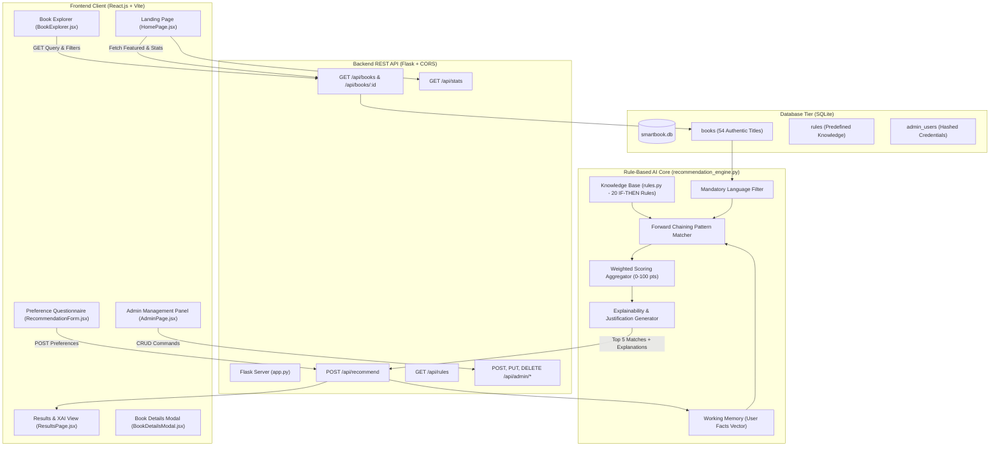

# SmartBook – Technical Architecture & System Design Document

This document provides an in-depth technical analysis of the **SmartBook** rule-based recommendation architecture, covering data flow, expert system inference mechanics, database schema, and API contracts.

---

## 1. System Architecture Diagram



---

## 2. Recommendation Algorithm Flowchart

```mermaid
flowchart TD
    Start([User Submits 6 Preferences]) --> ExtractFacts[Extract & Normalize Facts into Working Memory]
    ExtractFacts --> CheckLanguage{Mandatory Language Filter}
    
    CheckLanguage -->|English| FilterEN[Candidate Pool = English Books]
    CheckLanguage -->|Hindi| FilterHI[Candidate Pool = Hindi Books]
    CheckLanguage -->|Marathi| FilterMR[Candidate Pool = Marathi Books]
    CheckLanguage -->|Other / Empty| Warn[Return Graceful Language Notice]
    
    FilterEN --> MatchRules
    FilterHI --> MatchRules
    FilterMR --> MatchRules

    subgraph ForwardChaining [Forward Chaining Inference]
        MatchRules[Match Working Memory against 20 IF-THEN Rules]
        MatchRules --> CollectFired[Identify All Satisfied Rules]
        CollectFired --> ActionDeduce[Assert Knowledge Actions & Traits]
    end

    ActionDeduce --> EvaluateCandidates[Evaluate Each Candidate Book in Pool]

    subgraph ScoringMatrix [Weighted Scoring Metric (Max 100)]
        C1{Genre Match?} -->|Yes| S1[+40 Points]
        C1 -->|No| S1_0[+0 Points]
        C2{Mood Match?} -->|Yes| S2[+20 Points]
        C2 -->|No| S2_0[+0 Points]
        C3{Purpose Match?} -->|Yes| S3[+15 Points]
        C3 -->|No| S3_0[+0 Points]
        C4{Difficulty Match?} -->|Yes| S4[+15 Points]
        C4 -->|No| S4_0[+0 Points]
        C5{Length Category Match?} -->|Yes| S5[+10 Points]
        C5 -->|No| S5_0[+0 Points]
    end

    EvaluateCandidates --> ScoringMatrix
    S1 & S2 & S3 & S4 & S5 --> SumScore[Sum Total Compatibility Score]
    
    SumScore --> SortRank[Sort by Score DESC, Rating DESC, Title ASC]
    SortRank --> SliceTop5[Select Top 5 Books]
    SliceTop5 --> GenXAI[Construct XAI Justification & Rule Trace]
    GenXAI --> EndResponse([Return JSON Response to Frontend])
```

---

## 3. Forward Chaining Reasoning Mechanics

Forward chaining (data-driven reasoning) works from available facts to reach conclusions:

1. **Assertion Phase**:
   User input produces initial facts in working memory:
   $$\text{Facts} = \{\text{genre}: G, \text{mood}: M, \text{difficulty}: D, \text{length}: L, \text{language}: Lang, \text{purpose}: P\}$$

2. **Matching Phase**:
   For every rule $R_i \in \text{KB}$:
   $$\text{Premise}(R_i) \subseteq \text{Facts} \implies \text{Fire}(R_i)$$

3. **Execution Phase**:
   When rule $R_i$ fires, its target recommendation traits and justification text are logged into the inference trace.

4. **Deterministic Non-Conflict Scoring**:
   Traditional expert systems sometimes suffer from conflicting rules. SmartBook avoids this by enforcing bounded attribute scoring where each attribute can contribute at most once up to its fixed ceiling:
   $$\text{Score}(B) = \sum_{a \in \{\text{genre}, \text{mood}, \text{purpose}, \text{difficulty}, \text{length}\}} W_a \cdot \mathbb{I}(B_a = \text{Facts}_a)$$
   $$\text{Max Score} = 40 + 20 + 15 + 15 + 10 = 100$$

---

## 4. Database Schema Specification

### `books` Table
| Column | Type | Constraints | Description |
|---|---|---|---|
| `id` | INTEGER | PRIMARY KEY AUTOINCREMENT | Unique book ID |
| `title` | TEXT | NOT NULL | Official publication title |
| `author` | TEXT | NOT NULL | Primary author name |
| `genre` | TEXT | NOT NULL | Standard literary genre |
| `description` | TEXT | NOT NULL | Synopsis or book summary |
| `language` | TEXT | NOT NULL | Language edition (English, Hindi, Marathi) |
| `pages` | INTEGER | NOT NULL | Exact page count |
| `reading_difficulty` | TEXT | NOT NULL | Beginner, Intermediate, or Advanced |
| `suitable_mood` | TEXT | NOT NULL | Suitable emotional resonance |
| `reading_purpose` | TEXT | NOT NULL | Primary reader goal |
| `cover_image` | TEXT | NOT NULL | HTTP URL to book jacket cover |
| `rating` | REAL | DEFAULT 4.5 | Editorial star rating (0.0 - 5.0) |
| `created_at` | TIMESTAMP | DEFAULT CURRENT_TIMESTAMP | Record insertion timestamp |

---

## 5. API Endpoints Specification

### 1. `POST /api/recommend`
**Request Body**:
```json
{
  "genre": "Self-Help",
  "mood": "Motivated",
  "reading_difficulty": "Beginner",
  "preferred_length": "Medium",
  "language": "English",
  "reading_purpose": "Personal Development",
  "limit": 5
}
```

**Response Body (Extract)**:
```json
{
  "status": "success",
  "total_rules_evaluated": 20,
  "total_rules_fired": 4,
  "total_candidates_evaluated": 26,
  "user_preferences": {
    "genre": "Self-Help",
    "mood": "Motivated",
    "reading_difficulty": "Beginner",
    "preferred_length": "Medium",
    "language": "English",
    "reading_purpose": "Personal Development"
  },
  "matched_rules": [
    {
      "rule_id": "RULE_02",
      "name": "Motivational Self-Help Rule",
      "explanation": "You selected Self-Help with the goal of Motivation..."
    }
  ],
  "recommendations": [
    {
      "id": 1,
      "title": "Atomic Habits",
      "author": "James Clear",
      "compatibility_score": 100,
      "score_breakdown": {
        "genre_match": 40,
        "mood_match": 20,
        "purpose_match": 15,
        "difficulty_match": 15,
        "length_match": 10
      },
      "explanation": "Recommended because this book matches your Genre: Self-Help, Mood: Motivated, Purpose: Personal Development, Reading Level: Beginner, Length: Medium (320 pages)."
    }
  ]
}
```
